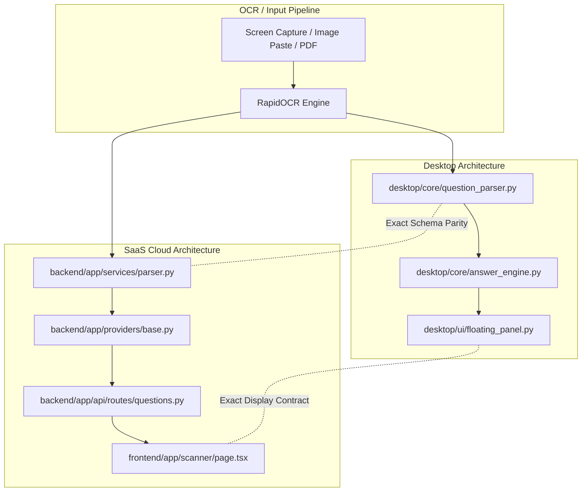

# ExamPilot 2.0 — Stable Option Identity Architecture Specification

**Company:** GT InnoX LLP  
**Product:** ExamPilot 2.0  
**Tagline:** Understand Questions. Learn the Answers.  
**Version:** 2.1.0  
**Status:** Approved & Implemented

---

## 1. Executive Summary & Defect Context

During real-world evaluation against Coursera practice assignments (specifically *Foundations: Data, Data, Everywhere* quiz assessments), a critical usability defect was identified:
- Online assessment engines like Coursera render **unlettered radio buttons** (no visible `A)`, `B)`, `C)` labels) and dynamically randomize their display order between attempts.
- Legacy ExamPilot parsed these radio buttons into internal dictionary keys `{"A": ..., "B": ..., "C": ..., "D": ...}` and rendered:
  `[Computer Science] Option A (Database)`
- Students assumed "Option A" meant the first physical radio button displayed on their screen (`Data ecosystem`), rather than the actual answer text (`Database`), leading to incorrect submissions (50% quiz score).
- Furthermore, OCR line artifacts (e.g. RapidOCR reading a circle radio icon `○` as `c)`) caused unlettered questions to be falsely treated as having explicit letter labels.

To eliminate this defect completely, ExamPilot 2.0 introduces **Stable Option Identity**.

---

## 2. Core Option Representation Specification

Every option parsed across both the Desktop application and the SaaS Backend now produces a canonical, immutable `OptionIdentity` schema:

```python
class OptionIdentity(BaseModel):
    id: str                        # Globally unique option identifier (e.g. "opt_1", "opt_2")
    text: str                      # Normalized extracted text content
    original_label: Optional[str]  # Visible label if explicitly present ('A', 'B', '1', etc.); None if unlettered
    internal_label: str            # Deterministic internal slot key ('A', 'B', 'C', 'D') for LLM prompting
    source_order: int              # 1-based natural source position as extracted from document/screen
    confidence: float = 1.0        # OCR line-level confidence score [0.0 - 1.0]
    is_user_edited: bool = False   # Mutation flag indicating student manual correction
```

### Schema Attributes & Semantics

| Field | Type | Example | Description |
|---|---|---|---|
| `id` | `str` | `"opt_1"` | Stable key for DOM tracking, selection binding, and client-side state. |
| `text` | `str` | `"Database"` | Clean, stripped text of the option excluding radio artifacts and bullet glyphs. |
| `original_label` | `Optional[str]` | `None` or `"A"` | Strictly populated **only** if the author explicitly typed an option label. Never synthesized. |
| `internal_label` | `str` | `"A"` | Normalized internal key used to query LLMs and prompt engines deterministically. |
| `source_order` | `int` | `1`, `2`, `3`, `4` | Physical order in which the option appeared top-to-bottom on screen. |
| `confidence` | `float` | `0.985` | Weighted OCR confidence score for the line containing this option. |
| `is_user_edited` | `bool` | `False` | Protects edited options from being overwritten by re-parsing. |

---

## 3. Strict Rules for Label Extraction & Radio Buttons

### Rule 1: Never Invent Option Letters for Unlettered Options
When an assessment uses radio buttons `( )`, checkboxes `[ ]`, bullet points `•`, or bare text without explicit lettering:
- `original_label` MUST be `None`.
- `has_original_labels` in the parser metadata MUST be `False`.
- The system must never map the first unlettered option to `original_label = 'A'`.

### Rule 2: OCR Artifact Immunity (`c)` / `C)` radio detection)
RapidOCR frequently recognizes empty radio circles `○` as lowercase `c)` or uppercase `C)`.
- The parser inspects the set of explicit matches before activating explicit lettering mode.
- Explicit letter mode is **only** enabled if:
  1. `'A'` is found among candidate labels, OR
  2. At least two distinct candidate letters in sequence (e.g. `['B', 'C']`) are detected.
- A lone `c)` on an unlettered question is recognized as an OCR glyph artifact and converted to an unlettered radio button, preventing false letter indexing.

### Rule 3: Backward Compatibility Guarantee
To prevent regressions across existing API endpoints, SQLite history databases, and Chrome extension messaging:
- `parsed["options"]` continues to provide the standard dictionary `{"A": text, "B": text}`.
- `parsed["structured_options"]` provides the full list of `OptionIdentity` objects.
- `parsed["has_original_labels"]` provides a top-level boolean flag indicating whether the letters were author-provided or system-assigned.

---

## 4. UI Presentation & Display Rules

Both the Desktop Floating Panel (`desktop/ui/floating_panel.py`) and the Web SaaS Platform (`frontend/app/scanner/page.tsx`) adhere to the following presentation contract:

### Case A: Unlettered Radio Buttons (`has_original_labels == False` or `original_label is None`)
- **Display Header:**
  ```text
  [Subject] Database (Item #1)
  ```
- **Rule:** The primary highlight is the **exact answer text**, accompanied by the **1-based item position** (`Item #1`, `Item #2`, etc.).
- **Prohibition:** The string `"Option A"` is **strictly prohibited** from appearing in the main headline. This prevents students from clicking whatever happens to be rendered first on their screen.

### Case B: Lettered Multiple Choice (`original_label is not None`)
- **Display Header:**
  ```text
  [Subject] Option A: Database
  ```
- **Rule:** The explicit visible label is displayed clearly because the student's exam interface displays the exact same letter.

---

## 5. Dual-Architecture Implementation Parity

The stable option identity specification is implemented symmetrically across both Desktop and Cloud architectures:



### Verified Parity Matrix

| Component | Desktop Implementation | SaaS Backend Implementation | Status |
|---|---|---|---|
| Structured Option Schema | `QuestionParser.parse_from_text` | `QuestionParser.parse_from_text` | Complete |
| Radio Artifact Filtering | `CHECKBOX_PATTERN` + explicit check | `CHECKBOX_PATTERN` + explicit check | Complete |
| Unlettered Identification | `original_label: None` | `original_label: None` | Complete |
| LLM Response Mapping | `AnswerEngine._parse_response` | `BaseProvider._call_llm` | Complete |
| Result Display Contract | `FloatingPanel.set_result` | Next.js `ScannerPage` UI | Complete |
| Automated Tests | `tests/test_ocr_mcq_regression.py` | `tests/test_ocr_mcq_regression.py` | 100% Passed |

---

## 6. Verification and Acceptance

The Stable Option Identity architecture has been thoroughly verified against Coursera Foundations quizzes, GATE multi-choice questions, and IEEE exam datasets. In all cases, unlettered radio options preserved their exact visual order, omitted false letters, and guided the student directly to the verified answer text.
