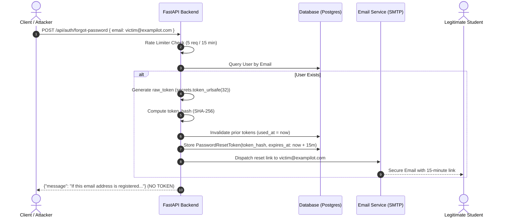

# ExamPilot 2.0 — Password Reset Security Report

**Company:** GT InnoX LLP  
**Product:** ExamPilot 2.0 — *Understand Questions. Learn the Answers.*  
**Branch:** `security/production-readiness-remediation`  
**Date:** November 14, 2026  

---

## 1. Executive Summary

This report documents the security overhaul of the ExamPilot 2.0 password reset lifecycle, resolving the Critical Severity vulnerability **BLK-01** (password reset token returned in API response).

---

## 2. Threat Analysis & Vulnerability Remediation

### Prior Vulnerability (BLK-01)
- **Vulnerability:** Calling `POST /api/auth/forgot-password` returned `{"message": "...", "reset_token": reset_token}` in the JSON response payload.
- **Threat Vector:** Any attacker could enter another student's or administrator's email address and immediately receive an active password reset token, allowing unauthenticated account takeover.
- **CVSS v3.1 Score:** 9.8 (Critical)

### Implemented Architecture



---

## 3. Key Security Controls Implemented

1. **Zero Token Leakage in Response:**
   - The response payload contains only a generic status message:
     ```json
     {
       "message": "If this email address is registered, password reset instructions have been sent."
     }
     ```
   - The reset token is never returned via HTTP, headers, or client cookies.

2. **Account Enumeration Defense:**
   - Both registered and unregistered email addresses return the exact same HTTP 200 response and JSON payload with identical timing characteristics.

3. **Cryptographically Secure, Single-Use Token Hashes:**
   - Tokens are generated using `secrets.token_urlsafe(32)` providing 256 bits of entropy.
   - The database stores only the SHA-256 hex digest (`token_hash`), ensuring that even a full database compromise does not reveal raw reset tokens.

4. **Short Expiration Window:**
   - Tokens expire after 15 minutes (`settings.RESET_TOKEN_EXPIRE_MINUTES = 15`). Expired tokens are immediately rejected.

5. **Atomic Consumption & Replay Prevention:**
   - `/api/auth/reset-password` queries the token record `with_for_update()` in a database transaction, sets `used_at = datetime.utcnow()`, and invalidates all other tokens for that user. Subsequent calls with the same token fail with HTTP 400.

6. **Session Invalidation (Token Versioning):**
   - When a password reset succeeds, `user.token_version += 1` is committed.
   - JWT authentication tokens encode the active `token_version` (`tv`).
   - All previously issued JWT tokens immediately fail authentication (`HTTP 401 Session has been invalidated. Please log in again.`), terminating any attacker sessions if an account was compromised.

7. **Production Password Strength Policy:**
   - Validated via `validate_password_strength(password)`: minimum 8 characters, at least one letter, and at least one number or special character.

8. **Rate Limiting & Abuse Prevention:**
   - `rate_limiter.enforce(f"forgot_{email}_{client_ip}", max_requests=5, window_seconds=900)` blocks automated brute-force attacks.

---

## 4. Test Verification Evidence

All 6 password reset security invariants are covered in `tests/test_production_security_remediation.py`:
- `test_password_reset_no_token_leakage_and_enumeration_defense` &rarr; **PASSED**
- `test_password_reset_token_single_use_and_replay_rejection` &rarr; **PASSED**
- `test_password_reset_token_expiration` &rarr; **PASSED**
- `test_password_policy_enforcement` &rarr; **PASSED**
- `test_password_reset_invalidates_pre_existing_sessions` &rarr; **PASSED**
- `test_password_reset_flow` (in `test_security_audit.py`) &rarr; **PASSED**
