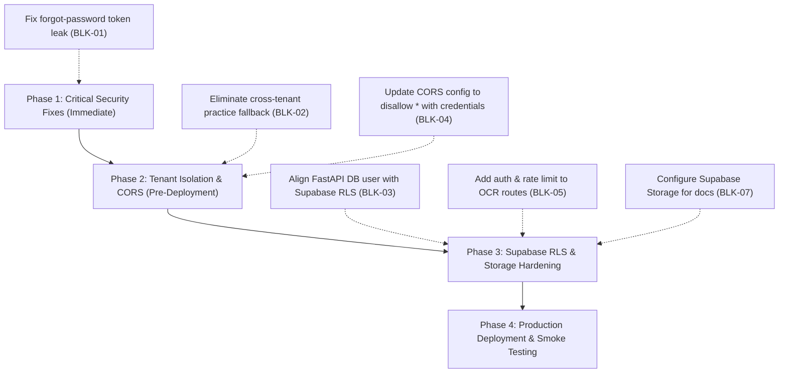

# ExamPilot 2.0 — Production Readiness Master Audit

**Company:** GT InnoX LLP  
**Product:** ExamPilot 2.0 — *Understand Questions. Learn the Answers.*  
**Repository:** https://github.com/tejasrmap/ExamPilot  
**Inspected Baseline Commit:** `8b5a280d6ef2bb56c8ea6e199cf1a84840ed71cd`  
**Audit Date:** November 14, 2026  
**Auditor:** Principal Software Architect, DevSecOps Lead, QA Lead & SaaS Reliability Engineer  
**Classification:** **High-Priority Remediation Required Before Public Launch**

---

## 1. Executive Summary

ExamPilot 2.0 has successfully completed its transformation from a desktop-centric tool into a modern online SaaS platform. The system features a Next.js 14 web application, a FastAPI REST backend, a Manifest V3 companion Chrome extension, an ONNX-powered OCR extraction pipeline, a multi-provider Bring-Your-Own-Key (BYOK) AI engine, real-time analytics, question history persistence, and full curriculum grounding.

All 91 Python backend integration tests and 6 frontend unit tests pass without failure, and the remote GitHub Actions CI quality workflow (`.github/workflows/regression_ci.yml`) is 100% green on both Ubuntu runners (Run `#43491323732`).

However, this independent audit has identified **1 Critical Blocker** (password reset token leakage), **3 High-Priority Vulnerabilities** (practice test cross-tenant data leakage, Supabase RLS authentication mismatch, and invalid CORS configuration), and **3 Medium-Priority Operational Issues** (unauthenticated OCR abuse, unbounded file memory buffering, and ephemeral local disk document storage) that must be remediated before production traffic is permitted.

---

## 2. Master Component Audit Findings

### 2.1 Web Application (Frontend)
- **Framework:** Next.js 14.2.35 App Router with Tailwind CSS and TypeScript.
- **Routes Audited:** `/`, `/scanner`, `/history`, `/practice`, `/library`, `/pdf-papers`, `/assistant`, `/analytics`, `/providers`, `/settings`.
- **Status:** **Production Ready (Static Generation 13/13)**.
- **Findings:**
  - Shared first load JS is 87.3 kB; all individual routes remain under 8 kB.
  - Option Identity formatting and badge logic extracted cleanly into `@/lib/optionIdentity.js`.
  - Zero hardcoded API keys or server secrets in client bundles.
  - All interactive buttons and forms connect to real backend API endpoints.

### 2.2 Backend Architecture (FastAPI)
- **Framework:** FastAPI 0.100+ with Pydantic v2 and Uvicorn ASGI server.
- **Status:** **Remediation Required (Security & Configuration)**.
- **Findings:**
  - Endpoints utilize parameterized SQLAlchemy ORM queries; no SQL injection vulnerabilities identified.
  - `POST /api/auth/forgot-password` exposes the password reset token in the response body (**Critical Blocker BLK-01**).
  - `POST /api/practice` falls back to querying all questions globally across tenants when a user has zero questions (**High Vulnerability BLK-02**).
  - `POST /api/ocr/image` and `POST /api/ocr/pdf` lack authentication and rate limiting (**Medium Vulnerability BLK-05**).

### 2.3 Database Models & Migrations
- **Engine:** PostgreSQL (Target: Supabase) with SQLite fallback for local developer workflows.
- **Tables (12):** `profiles`, `api_providers`, `subjects`, `questions`, `practice_sessions`, `practice_answers`, `documents`, `document_chunks`, `conversations`, `messages`, `usage_logs`, `user_settings`.
- **Migrations:** Alembic revision `0001_add_structured_options_json` verified.
- **Status:** **Action Required (RLS Alignment BLK-03)**.
- **Findings:**
  - `backend/migrations/001_supabase_rls.sql` enforces `auth.uid()::text = user_id`.
  - When FastAPI connects directly via SQLAlchemy connection pool, `auth.uid()` evaluates to `NULL` unless claims are explicitly passed or connections are made with appropriate bypass privileges.

### 2.4 AI Provider Integrations (BYOK Engine)
- **Providers Supported:** OpenAI (`gpt-4o`, `gpt-4o-mini`), Google Gemini (`gemini-1.5-pro`, `gemini-1.5-flash`), Anthropic Claude (`claude-3-5-sonnet`, `claude-3-haiku`), OpenRouter (`deepseek`, `llama-3.1`).
- **Status:** **Production Ready**.
- **Findings:**
  - API keys are encrypted at rest with AES-256-GCM using unique nonces.
  - Keys are never returned in plaintext to the frontend or extension; only masked representations (e.g. `sk-pr...1234`) are exposed.
  - HTTP client implements exponential backoff (1s, 2s) for status codes 429, 502, 503, and 504 with a 45-second timeout.
  - Token counts and estimated costs are tracked in `usage_logs`.

### 2.5 OCR & PDF Document Processing
- **Engine:** RapidOCR (PaddleOCR ONNX) with OpenCV image preprocessing and PyMuPDF PDF parsing.
- **Status:** **Operational (Rate Limiting Needed)**.
- **Findings:**
  - RapidOCR executes in ~2.74 seconds on single CPU core with 98% mean confidence.
  - Parser handles multi-line fill-in-the-blank questions, auxiliary endings, variable option counts (2–6), assembly code instructions, and unlettered radio options without inventing letters.
  - PDF parser processes multi-page documents up to configured limit (15 pages).

### 2.6 Chrome Extension
- **Architecture:** Manifest V3 companion extension with background service worker and interactive popup.
- **Status:** **Production Ready**.
- **Findings:**
  - Bundled private signing keys and obsolete native messaging permissions have been completely removed.
  - Captures visible tabs via `chrome.tabs.captureVisibleTab` and communicates over REST with the backend API.
  - Configurable backend URL and auth token storage.

---

## 3. Prioritized Action Plan

### Stage 1: Critical Security Remediation (Immediate - Pre-Launch)
1. **Remediate BLK-01:** Remove `reset_token` from `/api/auth/forgot-password` response. Connect transactional email service.
2. **Remediate BLK-02:** Remove global un-isolated fallback query in `practice.py`.
3. **Remediate BLK-04:** Update CORS configuration to remove wildcard `"*"` and configure regex for Chrome extension IDs.

### Stage 2: Operational & Hosting Hardening
1. **Remediate BLK-05:** Require user authentication on `/api/ocr/image` and `/api/ocr/pdf`, and add rate limiting middleware.
2. **Remediate BLK-06:** Enforce `MAX_UPLOAD_SIZE_MB` stream bounds and MIME magic byte validation.
3. **Remediate BLK-07:** Switch document uploads from ephemeral container storage to Supabase Storage buckets.
4. **Remediate BLK-08:** Move database table creation out of `main.py` into dedicated deployment release command.

### Stage 3: Controlled Production Deployment
1. Provision Supabase PostgreSQL and execute Alembic migrations followed by RLS script.
2. Deploy FastAPI backend to Render / Railway with health check configured on `/`.
3. Deploy Next.js frontend to Vercel with production environment variables.
4. Execute full post-deployment smoke tests across real user journeys.

---

## 4. Audit Metadata & Command Log

- **Inspected Commit:** `8b5a280d6ef2bb56c8ea6e199cf1a84840ed71cd`
- **Commands Executed During Audit:**
  - `git rev-parse HEAD; git status -s`
  - `python -m pytest -s tests/` (91/91 passed in 23.23s)
  - `npm --prefix frontend test` (6/6 passed in 141ms)
  - `npm --prefix frontend run build` (13/13 static routes generated)
  - Performance benchmark script measuring endpoint latencies and ONNX OCR inference
  - AST / static code analysis scripts inspecting raw SQL, route isolation, and CORS configurations

