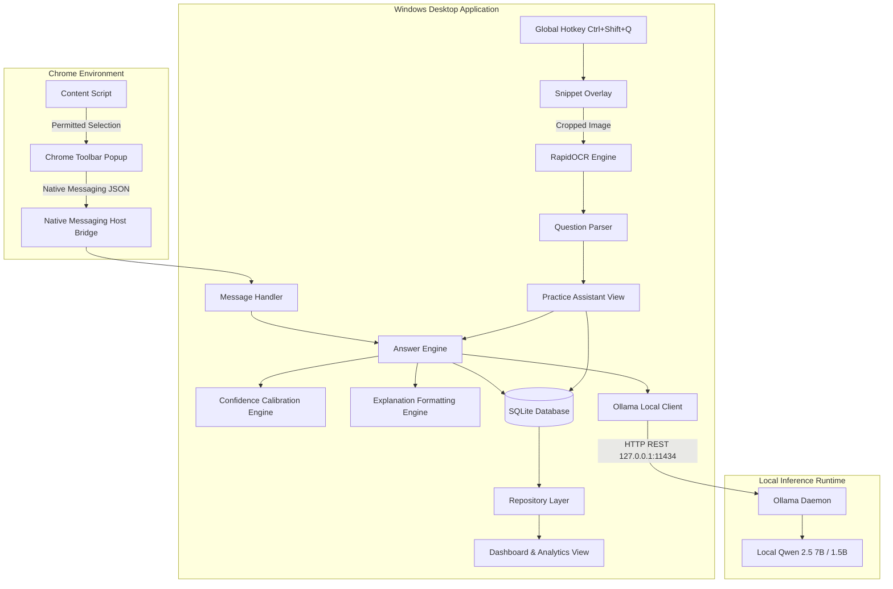

# ExamPilot — Architectural Specification
**GT InnoX LLP**

ExamPilot is engineered as a hybrid local system combining a PySide6 Windows desktop application, a Chrome Manifest V3 extension, an ONNX-accelerated OCR extraction engine, and an offline Ollama inference bridge.

---

## 1. System Architecture Diagram

---

## 2. Component Directory Responsibilities

| Subsystem | Location | Primary Responsibilities |
|-----------|----------|--------------------------|
| **Entry & App** | `desktop/main.py`, `desktop/app.py` | Application lifecycle, Qt styling, DPI management, unhandled exception traps. |
| **Configuration** | `desktop/config.py` | Theme palette, paths, default ports, model catalogs, shortcuts. |
| **Screen Capture** | `desktop/core/capture.py` | High-performance multi-monitor screenshot capture via MSS, transparent rubberband selection overlay. |
| **OCR Engine** | `desktop/core/ocr_engine.py` | RapidOCR (PaddleOCR ONNX weights), adaptive contrast preprocessing, token confidence scores. |
| **Question Parser** | `desktop/core/question_parser.py` | Regex structuring of single/multi-line questions, options A–E, numbers, and math symbols. |
| **AI Inference** | `desktop/ai/ollama_client.py` | Local Ollama HTTP API client (`/api/generate`, `/api/tags`, `/api/pull`), automatic retries, timeout management. |
| **Response Validation** | `desktop/ai/response_parser.py` | Strict JSON schema enforcement, Markdown code block stripping, fallback option text alignment. |
| **Confidence Engine** | `desktop/core/confidence_engine.py` | Calibrated certainty scoring factoring in hedge words and option distinctiveness. |
| **Database & Repo** | `desktop/database/` | SQLite database schema with WAL mode, migrations, indexes, backups, and user privacy wipe. |
| **Communication** | `desktop/communication/` | Chrome Native Messaging 32-bit length-prefixed JSON protocol host and IPC router. |
| **UI Views** | `desktop/ui/` | Modern dark UI (`#0B1020`), Sidebar navigation, Dashboard, Practice Assistant, Floating Panel, Analytics, Model Manager, Settings. |

---

## 3. Communication Security & Privacy

1. **Local-Only Communication**:
   - Ollama and Native Messaging communicate strictly over localhost (`127.0.0.1:11434` and standard OS pipes).
   - Non-local URLs are blocked by `desktop/security/privacy.py`.
2. **Chrome Native Messaging Protocol**:
   - Host is registered at `HKCU\Software\Google\Chrome\NativeMessagingHosts\com.gtinnox.exampilot`.
   - Length-prefixed 32-bit unsigned integer framing prevents buffer overflows and stream corruption.
3. **Data Retention**:
   - All questions and user feedback are stored locally in `%LOCALAPPDATA%\ExamPilot\exampilot.db`.
   - No cloud telemetry, analytics pings, or third-party trackers exist in the codebase.

